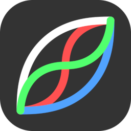

  

    
  

  <h1>Creative Tools</h1>

  

    
    

      <a href="/photocurves/"><h3>Photo Curves</h3></a>
      
Photo and video color grading tool and 3D LUT creator.

    

  

  

    <a href="/cropimage/" aria-label="Open the free online image cropper and resizer">
      <svg class="app-icon crop-icon" viewBox="0 0 128 128" role="img" aria-label="Crop and Resize Image online tool icon">
        <rect width="128" height="128" rx="28" fill="#333333"/>
        <path d="M36 20v64c0 5 4 8 8 8h64M20 36h64c5 0 8 4 8 8v64" fill="none" stroke="#fff" stroke-width="10" stroke-linecap="round" stroke-linejoin="round"/>
      </svg>
    </a>
    

      <a href="/cropimage/"><h3>Crop and Resize Images Online</h3></a>
      
Crop and resize images, round corners, and create icons or avatars.

    

  

  

    <a href="/cropvideo/" aria-label="Open the free online video cropper, trimmer, and resizer">
      <svg class="app-icon crop-icon" viewBox="0 0 128 128" role="img" aria-label="Crop, Trim, and Resize Video online tool icon">
        <rect width="128" height="128" rx="28" fill="#333333"/>
        <path d="M36 20v64c0 5 4 8 8 8h64M20 36h64c5 0 8 4 8 8v64" fill="none" stroke="#fff" stroke-width="10" stroke-linecap="round" stroke-linejoin="round"/>
        <path d="M57 50.2c-1.6-.9-3.5.2-3.5 2v23.6c0 1.9 1.9 2.9 3.5 2l20-11.8c1.6-.9 1.6-3.1 0-4z" fill="#fff"/>
      </svg>
    </a>
    

      <a href="/cropvideo/"><h3>Crop, Trim, and Resize Videos Online</h3></a>
      
Adjust video framing, duration, and output size, with controls for quality and frame rate.

    

  

  

    <a href="/trimaudio/" aria-label="Open the free online audio trimmer with waveform">
      <svg class="app-icon crop-icon" viewBox="0 0 128 128" role="img" aria-label="Trim Audio online tool icon">
        <rect width="128" height="128" rx="28" fill="#333333"/>
        <path d="M24 59v10m10-23v36m10-52v68m10-55v42m10-68v94m10-78v62m10-48v34m10-28v22m10-16v10" fill="none" stroke="#fff" stroke-width="7" stroke-linecap="round"/>
      </svg>
    </a>
    

      <a href="/trimaudio/"><h3>Trim Audio Online</h3></a>
      
Use a visual waveform for precise trimming, preview audio, adjust quality, and mix stereo to mono.

    

  

  

    <a href="/appscreenshots/" aria-label="Open the free app store screenshot creator">
      <svg class="app-icon" viewBox="0 0 128 128" role="img" aria-label="App Screenshot Creator online tool icon">
        <defs>
          <linearGradient id="screenshot-card-left" x1="0" y1="0" x2="1" y2="1"><stop stop-color="#536bc6"/><stop offset="1" stop-color="#9464b6"/></linearGradient>
          <linearGradient id="screenshot-card-center" x1="0" y1="0" x2="1" y2="1"><stop stop-color="#743b9b"/><stop offset="1" stop-color="#e68b7c"/></linearGradient>
          <linearGradient id="screenshot-card-right" x1="0" y1="0" x2="1" y2="1"><stop stop-color="#e68b7c"/><stop offset="1" stop-color="#f4c28e"/></linearGradient>
          <g id="screenshot-card-content">
            <path d="M10 12h18" stroke="#fff" stroke-opacity=".9" stroke-width="3" stroke-linecap="round"/>
            <path d="M13 18h12" stroke="#fff" stroke-opacity=".6" stroke-width="2" stroke-linecap="round"/>
            <rect x="5" y="28" width="28" height="39" rx="3" fill="#fff" fill-opacity=".93"/>
            <path d="M5 38h28M5 48h28M5 58h28" stroke="#e6e6e6" stroke-width="2"/>
          </g>
        </defs>
        <rect width="128" height="128" rx="28" fill="#333333"/>
        <g transform="translate(19 34) rotate(-10 19 36)"><rect width="38" height="72" rx="4" fill="url(#screenshot-card-left)"/><use href="#screenshot-card-content"/></g>
        <g transform="translate(71 34) rotate(10 19 36)"><rect width="38" height="72" rx="4" fill="url(#screenshot-card-right)"/><use href="#screenshot-card-content"/></g>
        <g transform="translate(45 23)"><rect x="-1" y="1" width="40" height="74" rx="5" fill="#000" fill-opacity=".15"/><rect width="38" height="72" rx="4" fill="url(#screenshot-card-center)"/><use href="#screenshot-card-content"/></g>
      </svg>
    </a>
    

      <a href="/appscreenshots/"><h3>App Screenshot Creator</h3></a>
      
Create App Store and Google Play screenshots with descriptions and custom backgrounds.

    

  

  

    <a href="/colorpalette/" aria-label="Open the free online UI color palette generator">
      <svg class="app-icon crop-icon" viewBox="0 0 128 128" role="img" aria-label="UI Color Palette Generator online tool icon">
        <rect width="128" height="128" rx="28" fill="#333333"/>
        <circle cx="64" cy="41" r="15" fill="#42a1eb"/>
        <circle cx="41" cy="80" r="15" fill="#eb42a1"/>
        <circle cx="87" cy="80" r="15" fill="#a1eb42"/>
      </svg>
    </a>
    

      <a href="/colorpalette/"><h3>UI Color Palette Generator</h3></a>
      
Create a color palette from one color and preview it in light and dark layouts.

    

  

  © 2020-2026 Curved Nebula

